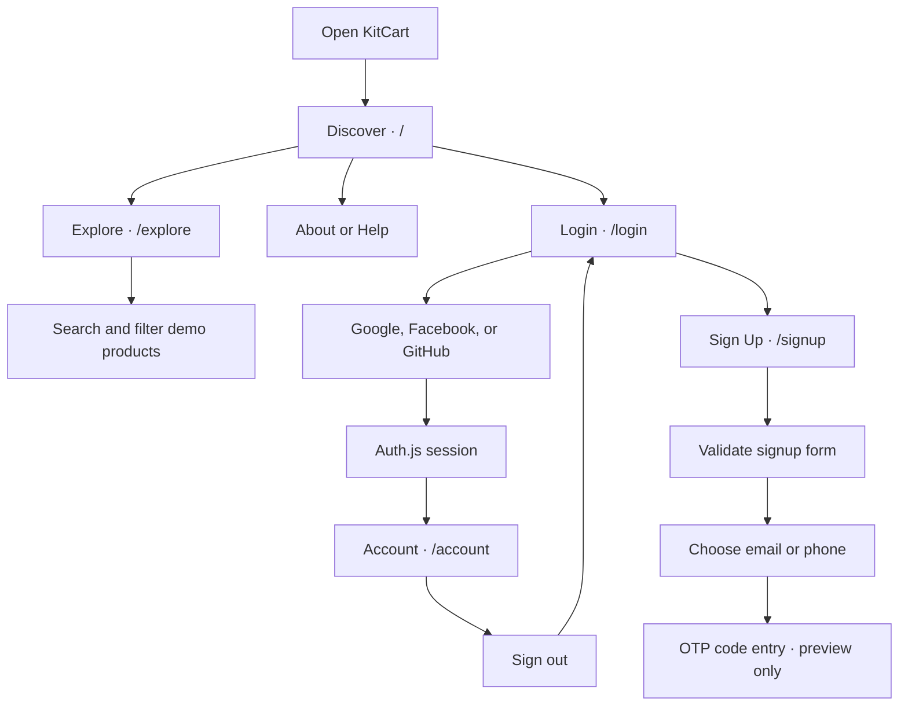
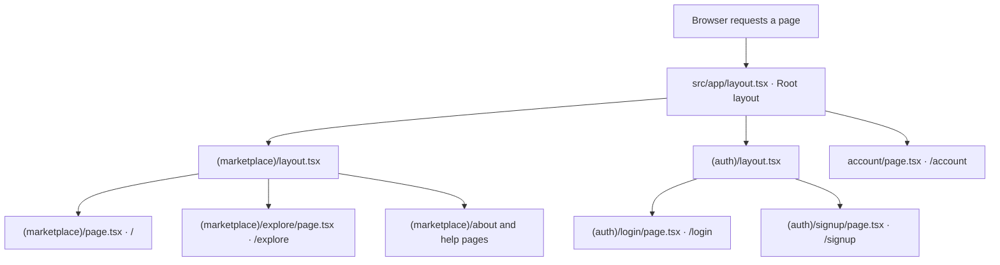
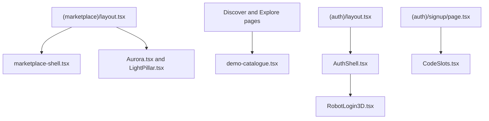

<div align="center">
  
  <h1>KitCart</h1>
  <p><strong>Your friendly shopping companion</strong></p>
  <p>A digital marketplace prototype with an interactive 3D mascot.</p>
  <p>Next.js · TypeScript · Three.js · Auth.js · PostgreSQL foundation</p>
</div>

---

[Project status](#project-status) · [App flow](#app-flow) · [Source file flow](#source-file-flow) · [3D mascot](#3d-mascot) · [Database](#database) · [Project structure](#project-structure) · [Local development](#local-development)

## Overview

KitCart is a marketplace prototype for discovering digital products, from dashboards and automation kits to website templates and presentation systems. The storefront uses a shared Aurora and Light Pillar background that stays mounted as visitors navigate between pages. Login and Sign Up feature a rigged 3D robot that tracks the pointer, changes its visor expression, and reacts to form interactions.

> The storefront and source-file map describe the [frontend development branch](https://github.com/blaze2310/kitcart/tree/feature/frontend-development). The PostgreSQL foundation lives on a separate branch and is not yet connected to this frontend.

## Project Status

| Area | Current state |
| --- | --- |
| **Storefront** | Discover, Explore, About, and Help are implemented. Page transitions support reduced motion. |
| **Catalogue** | Four demo listings are available. Explore supports keyword search and category filters. |
| **Social sign-in** | Google, Facebook, and GitHub are wired through Auth.js. Each provider requires local configuration. |
| **Account page** | Signed-in visitors can view their account and sign out. Visitors without a session are redirected to Login. |
| **Login and signup forms** | Form UI, signup validation, and password visibility controls are implemented. Credential sign-in and account creation are not connected. |
| **OTP verification** | Signup previews email or phone selection and code entry. No real code is sent or verified. |
| **Database** | A separate PostgreSQL branch contains the authentication schema and server-side database and password utilities. |
| **Commerce** | The catalogue is demo-only. Cart, checkout, payments, and seller onboarding are not live. |

### Storefront Routes

| Route | What it contains |
| --- | --- |
| `/` | Discover hero and the four demo product cards |
| `/explore` | Search and category filters for the demo catalogue |
| `/about` | What KitCart is building for creators and shoppers |
| `/help` | What visitors can try in the current prototype |

## App Flow

This diagram shows **what the visitor does**. The social sign-in path can reach the account page when a provider is configured. The signup path ends at the OTP preview.



## Source File Flow

This diagram shows **which files Next.js uses to render a page**. The root layout wraps every page. Next.js selects a `page.tsx` from the requested URL and applies any nested layout around it. The arrows show how files fit together, not one page directly calling another.



For example, opening `/` renders the Discover page inside the marketplace layout, which is itself inside the root layout. Clicking **Login** requests `/login`. The root layout still wraps the page, but Next.js uses the auth layout and the login page instead. Clicking **Sign Up** changes the page inside that same auth layout, so the robot stays mounted.

### What the Layouts and Pages Connect To



- **Storefront:** `marketplace-shell.tsx` handles navigation, search submission, and page transitions. Discover and Explore both import `demo-catalogue.tsx`, so the listing data and product cards have one home.
- **Authentication UI:** `AuthShell.tsx` keeps the robot scene mounted and shares form-interaction controls with Login and Sign Up. `RobotLogin3D.tsx` translates those signals into reactions. Sign Up renders `CodeSlots.tsx` for its OTP preview.
- **Social sign-in:** The login page starts the flow through the Auth.js client. Requests to `/api/auth/*` are handled by `src/app/api/auth/[...nextauth]/route.ts`, which exports handlers from `src/auth.ts`. The Account page also uses `src/auth.ts` to check the session and sign out. This API flow is separate from the page layouts above.

### Where to Make Changes

| If you want to change… | Start here |
| --- | --- |
| The site-wide layout or global stylesheet imports | `src/app/layout.tsx` |
| The Discover homepage and its hero section | `src/app/(marketplace)/page.tsx` |
| Explore’s search and category filtering | `src/app/(marketplace)/explore/page.tsx` |
| The About or Help page copy | `src/app/(marketplace)/about/page.tsx` or `src/app/(marketplace)/help/page.tsx` |
| Storefront navigation, search box, or page transitions | `src/features/shop/marketplace/marketplace-shell.tsx` |
| Aurora and Light Pillar settings on the storefront | `src/app/(marketplace)/layout.tsx` |
| The background layers and their positioning | `src/app/(marketplace)/marketplace-layout.module.css` |
| Demo listing data or product cards | `src/features/shop/marketplace/demo-catalogue.tsx` |
| The Login form or social sign-in buttons | `src/app/(auth)/login/page.tsx` |
| Signup fields, validation, or the OTP preview flow | `src/app/(auth)/signup/page.tsx` |
| The shared auth layout and robot canvas | `src/features/auth/components/AuthShell.tsx` |
| Password tooltip or verification modal styling | `src/features/auth/styles/signup-modal.css` |
| Robot reactions during Login and Sign Up | `src/features/robot/3d/RobotLogin3D.tsx` |
| Auth.js providers or session configuration | `src/auth.ts` |
| Account page or sign-out UI | `src/app/account/page.tsx` |

## 3D Mascot

Login and Sign Up share an authentication layout that keeps the robot mounted when the form changes. The robot uses rigged GLB assets, Three.js, React Three Fiber, and Drei. Animation playback, head tracking, blinking, and visor rendering are organized separately.

| Interaction | Robot response |
| --- | --- |
| Open the authentication screen | Waves, then returns to idle |
| Move the pointer | Tracks it with its head when the active animation allows |
| Focus the username field | Plays a character gesture |
| Reveal the password | Plays a peek or turn reaction |
| Enter mismatched passwords on signup | Plays a sad reaction |
| Click the robot | Changes its expression or plays a reaction |

## Database

The PostgreSQL foundation defines **seven authentication tables**. This section describes what the tables are designed to store. It does not contain database records, credentials, or connection details.

| SQL table | What it stores |
| --- | --- |
| `users` | Core account records, display information, and account status |
| `user_profiles` | Profile details and contact verification status linked to a user |
| `oauth_accounts` | Links between a KitCart user and external sign-in accounts |
| `password_credentials` | Password hashes and when they were last updated |
| `pending_registrations` | Temporary signup records awaiting verification, with expiry and completion status |
| `verification_challenges` | Verification requests for users or pending signups, including delivery channel, expiry, and attempt tracking |
| `login_events` | Authentication event history, optionally linked to a user |

The database branch includes server-side **Argon2id** password utilities. The frontend currently uses **Auth.js JWT sessions** and does not read or write these seven tables for social sign-in.

| Branch | Scope |
| --- | --- |
| [`feature/frontend-development`](https://github.com/blaze2310/kitcart/tree/feature/frontend-development) | Marketplace, interactive auth UI, social sign-in, and development labs |
| [`feature/postgresql-database`](https://github.com/blaze2310/kitcart/tree/feature/postgresql-database) | Database connection and health helpers, password utilities, and the [authentication foundation migration](https://github.com/blaze2310/kitcart/blob/ab5303b/database/migrations/001_auth_foundation.sql) |

## Project Structure

| Location | Responsibility |
| --- | --- |
| `src/app/(marketplace)/` | Storefront pages, shared layout, and background styles |
| `src/app/(auth)/` | Login, Sign Up, and the shared authentication layout |
| `src/app/account/` | Session-protected account page |
| `src/app/api/auth/[...nextauth]/` | Auth.js API handler |
| `src/app/(labs)/` | Visual effects, robot interactions, and visor calibration experiments |
| `src/features/shop/marketplace/` | Marketplace shell, demo catalogue, and reusable styles |
| `src/features/auth/` | Auth shell, verification components, and auth-specific styles |
| `src/features/robot/` | Active 3D robot implementation and earlier 2D experiments |
| `src/components/` | Shared effects, including Aurora and Light Pillar |
| `src/auth.ts` and `src/proxy.ts` | Auth.js configuration and Next.js request proxy |
| `public/` and `scripts/robot/` | Runtime robot assets and development tooling |
| `backups/` | Historical snapshots for recovery, not live application code |

Parenthesized folders group related pages without adding a segment to their URLs. See the [project structure guide](https://github.com/blaze2310/kitcart/blob/feature/frontend-development/docs/architecture/PROJECT_STRUCTURE.md) for more detail.

<details>
<summary><strong>Development labs to try</strong></summary>

| Route | What it tests |
| --- | --- |
| `/aurora-test` | Aurora on its own |
| `/pillar-test` | Light Pillar on its own |
| `/background-combo-test` | Both background effects together |
| `/robot-interaction-test` | Robot interaction behavior |
| `/visor-expression-3d` | Visor expressions on the 3D model |

</details>

## Local Development

Use a Node.js version compatible with Next.js 16 and npm. From a fresh checkout:

```bash
git clone --branch feature/frontend-development https://github.com/blaze2310/kitcart.git
cd kitcart
npm ci
npm run dev -- --port 3000
```

Open [http://localhost:3000](http://localhost:3000). The demo storefront does not require PostgreSQL. Social sign-in requires local Auth.js and provider configuration. Keep credentials in `.env.local` and out of Git, including out of backup snapshots.

### Check Changes

```bash
npx next typegen && npx tsc --noEmit
npm run lint
npm run build
```

For a quick visual check, navigate **Discover → Explore → About** and confirm the background does not restart. Then switch **Login → Sign Up** and test the robot, password visibility button, and password requirements tooltip.

## What’s Next

- Connect credential-based signup and sign-in to PostgreSQL.
- Add real verification delivery and code validation.
- Replace demo products with persistent catalogue data.
- Build cart, checkout, and seller onboarding.

---

<p align="center"><strong>KitCart</strong> · Digital marketplace and interactive companion prototype</p>
