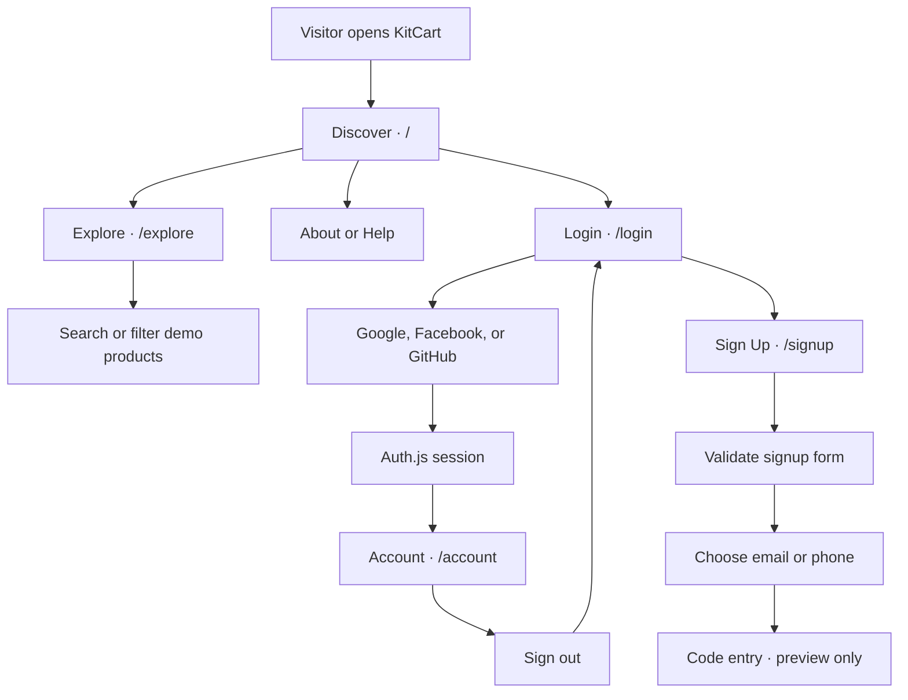

<div align="center">
  
  <h1>KitCart</h1>
  <p><strong>Your friendly shopping companion</strong></p>
  <p>A digital marketplace prototype with an interactive 3D mascot.</p>
  <p>Next.js App Router · TypeScript · Three.js · Auth.js</p>
</div>

---

[Project Status](#project-status) · [App Flow](#app-flow) · [3D Mascot](#3d-mascot) · [Database](#database) · [Project Structure](#project-structure) · [Local Development](#local-development)

## Overview

KitCart brings two ideas together in one Next.js application: a storefront for discovering digital products and a sign-in experience with an interactive robot companion. The storefront has a shared animated background that stays in place while visitors move between pages. The robot reacts to what visitors do on the authentication screens, from focusing the username field to revealing a password.

The current storefront uses a **demo catalogue**, not live inventory. Social sign-in is wired through Auth.js. Credential-based authentication and real verification are separate from the current frontend experience.

## Project Status

| Area | What exists today | Status |
| --- | --- | --- |
| **Storefront** | Discover, Explore, About, and Help with a shared Aurora and Light Pillar background | Implemented |
| **Catalogue** | Four demo products with search and category filters on Explore | Implemented with demo data |
| **Navigation** | Client-side page transitions with a persistent background and reduced-motion support | Implemented |
| **Social sign-in** | Google, Facebook, and GitHub through Auth.js, using JWT sessions | Wired up. Provider configuration is required locally. |
| **Account page** | Session check, signed-in identity, and sign-out. Visitors without a session are redirected to Login. | Implemented |
| **Login and signup UI** | Credential forms, password visibility controls, and signup validation | UI implemented. Credential sign-in and account creation are not connected. |
| **OTP verification** | Email or phone selection and an in-page code-entry overlay | UI preview. No real code is sent or verified. |
| **PostgreSQL** | Seven-table migration, database connection and health helpers, and Argon2id password utilities | Foundation on a separate branch. Not connected to the frontend checkpoint. |
| **Commerce** | Cart and seller onboarding controls show development notices | No live cart, checkout, or payment flow |

### Branch checkpoints

| Branch | Verified checkpoint | Scope |
| --- | --- | --- |
| [`feature/frontend-development`](https://github.com/blaze2310/kitcart/tree/feature/frontend-development) | [`ac36564`](https://github.com/blaze2310/kitcart/commit/ac36564) | Reorganized frontend, shared marketplace layout, auth styling, and development labs |
| [`feature/postgresql-database`](https://github.com/blaze2310/kitcart/tree/feature/postgresql-database) | [`ab5303b`](https://github.com/blaze2310/kitcart/commit/ab5303b) | SQL migration and server-side database and password utilities |

## App Flow

The storefront and authentication screens are part of the same app. Signup currently ends at a verification preview, while the social sign-in path can reach the account page when its provider is configured.



### Storefront routes

| Route | What you’ll see |
| --- | --- |
| `/` | Discover hero and four demo listings |
| `/explore` | Searchable demo catalogue and category filters |
| `/about` | KitCart’s purpose for creators and shoppers |
| `/help` | Available preview features and links to try them |

The demo listings cover a revenue dashboard, an n8n workflow kit, a website starter, and a presentation system. They’re used to test discovery and product-card design, not purchases.

## 3D Mascot

Login and Sign Up share an authentication layout. It keeps the same robot component mounted while the form changes, so switching screens doesn’t recreate the 3D scene.

| Interaction | Robot behavior |
| --- | --- |
| Open the authentication screen | Plays a welcome wave, then returns to idle |
| Move the pointer | Tracks the pointer with its head when the active animation allows it |
| Focus the username field | Plays a character gesture |
| Show the password | Plays a peek or turn reaction |
| Enter passwords that don’t match on signup | Plays a sad reaction |
| Click the robot | Changes its visor expression or plays a reaction |

The active implementation uses rigged GLB assets, Three.js, React Three Fiber, and Drei. Animation playback, head tracking, blinking, and visor rendering are organized separately under `src/features/robot/3d/`. The earlier 2D experiments are retained in `src/features/robot/2d/`.

## Database

The PostgreSQL branch contains one foundation migration defining **seven authentication tables**. This section describes what the tables are for, not what’s in a running database. The frontend checkpoint does not use these tables for its Auth.js sessions.

| SQL table | What it stores |
| --- | --- |
| `users` | The core account record, including display information, email verification status, and whether the account is active |
| `user_profiles` | Profile details linked to a user, including username and phone verification status |
| `oauth_accounts` | Links between a KitCart user and their external sign-in accounts |
| `password_credentials` | The stored password hash for an account and when it was last updated |
| `pending_registrations` | Temporary signup records that have not completed verification, with expiry and completion tracking |
| `verification_challenges` | Verification requests for an existing user or pending signup, including the channel, expiry, and attempt tracking. Codes are represented by hashes in the schema. |
| `login_events` | Authentication event history, optionally linked to a user |

`users` is the central account record. Profiles, OAuth links, and password credentials refer to it. A verification challenge can refer to either an existing user or a pending registration. Server-side password utilities on the database branch use **Argon2id**. There is no SQL session table in this migration. The current frontend uses JWT sessions through Auth.js.

See the [authentication foundation migration](https://github.com/blaze2310/kitcart/blob/ab5303b/database/migrations/001_auth_foundation.sql).

## Project Structure

| Location | Responsibility |
| --- | --- |
| `src/app/(marketplace)/` | Storefront route entry points, shared layout, and background styles |
| `src/app/(auth)/` | Login and Sign Up route entry points and shared auth layout |
| `src/app/account/` | Session-protected account page |
| `src/app/api/auth/[...nextauth]/` | Auth.js API route handler |
| `src/app/(labs)/` | Visual, robot, and visor development routes |
| `src/features/shop/marketplace/` | Marketplace shell, demo catalogue, and reusable storefront styles |
| `src/features/auth/` | Shared auth shell, verification UI, and auth-specific styles |
| `src/features/robot/` | Active 3D implementation and earlier 2D experiments |
| `src/components/` | Shared visual effects, including Aurora and Light Pillar |
| `src/auth.ts` and `src/proxy.ts` | Auth.js configuration and Next.js request proxy entry point |
| `public/` | Runtime robot models, animations, and mascot assets |
| `scripts/robot/` | Rigging, mapping, and preview tooling |
| `backups/` | Historical source snapshots for reference and recovery, not live application code |

The folders in parentheses group related routes without changing their URLs. For more detail, see the [project structure guide](docs/architecture/PROJECT_STRUCTURE.md).

<details>
<summary><strong>Development lab routes</strong></summary>

| Route | Purpose |
| --- | --- |
| `/aurora-test` | Test Aurora independently |
| `/pillar-test` | Test Light Pillar independently |
| `/background-combo-test` | Compare the combined background effects |
| `/design-lab` | Experiment with storefront styling |
| `/render-test` | Check basic page rendering |
| `/robot-3d` | Inspect the 3D robot |
| `/robot-interaction-test` | Test robot interactions |
| `/visor-expression-3d` | Inspect visor expressions on the 3D model |
| `/visor-3d-calibration` | Adjust and inspect visor placement |

</details>

## Technology

| Layer | Technology |
| --- | --- |
| Web app | Next.js 16 App Router, React 19, TypeScript |
| Styling | CSS Modules, Tailwind CSS v4, PostCSS |
| Background effects | React Bits Aurora and Light Pillar |
| 3D rendering | Three.js, React Three Fiber, Drei, GLB assets |
| Social authentication | Auth.js with Google, Facebook, and GitHub |
| Database foundation | PostgreSQL, SQL migrations, Node PostgreSQL driver, Argon2id |

## Local Development

### Run the frontend

Use a Node.js version compatible with Next.js 16 and npm. From a fresh checkout:

```bash
git clone --branch feature/frontend-development https://github.com/blaze2310/kitcart.git
cd kitcart
npm ci
npm run dev -- --port 3000
```

Open [http://localhost:3000](http://localhost:3000). If you already have the frontend branch checked out, skip the clone step and run the install and dev commands from the project root.

Social sign-in requires local Auth.js and provider configuration. Keep credentials in `.env.local` and out of Git, including out of backup snapshots. The PostgreSQL migration is not needed to browse the demo storefront.

### Check changes

```bash
npx next typegen && npx tsc --noEmit
npm run lint
npm run build
```

After moving routes, regenerate Next.js route types before running TypeScript. If the checker still points to paths that no longer exist, stop the dev server, clear the generated `.next/` output, and regenerate the types.

For a quick manual check, navigate **Discover → Explore → About** and confirm that the background stays mounted. Then switch **Login → Sign Up** and check the robot, password visibility toggle, and password requirements tooltip.

## What’s Next

- Connect credential-based signup and sign-in to the PostgreSQL foundation.
- Implement real verification delivery and code validation.
- Replace demo listings with persistent product data.
- Build the cart, checkout, and seller onboarding flows.

---

<p align="center"><strong>KitCart</strong> · Marketplace and interactive companion prototype</p>